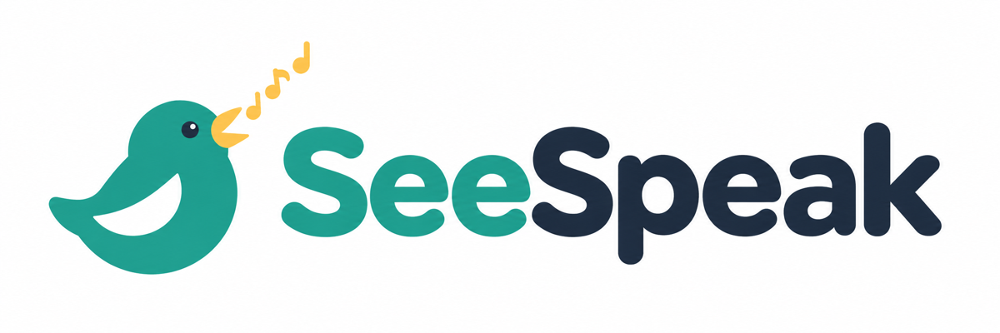

# SeeSpeak

Practice the speech sounds your ears miss.

If you cannot hear high sounds like "s" and "sh", you cannot copy them. So "cats" becomes "cat" and "sip" blurs into "ship". Speech therapy helps, but sessions are short and far apart, and practice at home has no feedback. SeeSpeak is the practice in between: say a word to your phone, and it shows you, by color, by a live meter and by vibration, whether the sound was there.

## Live demo

Production: https://seespeak.vercel.app (follows `main`). The tuning page is https://seespeak.vercel.app/lab.

Demo video (1:59): https://github.com/whynobro/SeeSpeakAi/releases/tag/demo-video (direct file: [seespeak-demo.mp4](https://github.com/whynobro/SeeSpeakAi/releases/download/demo-video/seespeak-demo.mp4)). Video files live in releases, never in the repo.

Pull request preview links ask for a Vercel login until Michael turns that off in the Vercel project settings. Until then, test on the production link after your pull request merges.

## How it works

1. **Report.** Start from a speech therapist's report (the sounds and goals they set), or take the test in the app (a one-minute hearing check plus a few starting words).
2. **Curated plan.** The brain (Claude) turns the report into a plan: which sounds, which words, what goal, in what order.
3. **Training.** Three views of each sound: the mouth (where tongue and lips go), a live graph of your sound, and a frequency meter that slides between "sh" and "s". The phone gives an instant result by color, icon and vibration. Then the brain reads your scores and tells you what to change and what to do next.
4. **Goal: better pronunciation.** Before and after accuracy for each sound.

The full plan, and who builds what, is in [docs/PLAN.md](docs/PLAN.md).

For people who choose to work on spoken English. Sign language is welcome: sign cards are an optional setting. SeeSpeak is practice between speech therapy sessions. It is not therapy, not a diagnosis and not a hearing test.

## What the phone does and what the AI does

- **Listening is signal processing, on the phone.** The app measures the pitch of the hiss (an "s" sits around 4 to 8 kHz, an "sh" around 2 to 4 kHz) and checks that it lands in the right place in the word. We do not use speech recognition to judge speech. In a 2024 test of four current systems, it got 52.6% of words wrong for deaf and hard-of-hearing adults and 5% for hearing adults. Even for deaf adults who speak and do not sign, it got about 1 word in 5 wrong ([Zhao 2024](https://koenecke.infosci.cornell.edu/files/Laryngoscope_Zhao2024.pdf)).
- **The brain is AI (Claude).** It builds the curated plan from the report, and after each try it reads the scores (numbers, never audio) and says what to change and what to do next. It also gets the shape of the sound over the word (a few numbers, still never audio), so its tip can say what actually happened. Being wired up this weekend: until the key is in, built-in rules do both jobs, and they stay as the fallback.

## Privacy

- Your voice is analysed in the phone browser. Audio is never uploaded or stored.
- Practice history stays on the device. No accounts.
- The brain receives the report with names removed, and score numbers. Never your voice. Nothing is stored on the server.

## Honest limits

- Four sounds are scored today: "s", "sh", "z" and "ch".
- It checks that the hiss is there and which hiss it is. It does not judge the whole word.
- The "z" and "ch" limits were set on synthetic sounds only and need real voices. A "z" is an "s" hiss with the voice on; a "ch" is a burst then a short "sh". Both are tested on /lab.
- Thresholds are starting values, tuned on test sounds and a few voices, not on a clinical data set.
- Lisp detection is new. It calls a lisp only when an "s" or "z" hiss is both weak next to the vowel and flat (no strong peak), and it was tuned on synthetic sounds and very few real voices, so it can still miss a lisp.
- Vibration works on Android phones only. iPhones have no vibration for web pages.

## Similar products

| Product                                                               | What it does                                                                                  | How SeeSpeak differs                                                                    |
| --------------------------------------------------------------------- | --------------------------------------------------------------------------------------------- | --------------------------------------------------------------------------------------- |
| [SpeechLP](https://apps.apple.com/us/app/-/id6752866135)              | AI articulation games for young children, with no mention of hearing loss                     | Its feedback assumes the child can hear the difference. Ours is built for hearing loss. |
| [SpeechPath](https://apps.apple.com/us/app/speechpath/id6745437939)   | Pronunciation practice for deaf users with recognition scoring                                | Our targets come from the user's own hearing profile, with a live meter and vibration.  |
| [MED-EL ReDi](https://apps.apple.com/us/app/-/id1506576790)           | Listening and speech practice from an implant maker                                           | Not tied to a device brand. Personal targets.                                           |
| [Neosensory Clarify](https://neosensory.com/blog/neosensory-clarify/) | Wristband that turns high-pitched speech sounds into vibration, to help you understand speech | That helps you hear the sounds. We help you say them, with only a phone.                |
| ELSA-style accent apps                                                | Pronunciation for second-language learners                                                    | They assume you can hear the target sound.                                              |

Sources and the full prior-art notes are in [docs/research.md](docs/research.md).

## Quick start

You need Node 24.

```bash
npm install
cp .env.example .env.local
npm run dev
```

Open http://localhost:3000. The tuning page is at `/lab`. `/lab/guided` is a hands-free 24-step test script that saves numbers to the shared test log.

The phone microphone only works over HTTPS. So to try it on a phone, open the Vercel preview link of your pull request, not your laptop's address.

The app runs without any keys. Never commit `.env.local` or any key. The repo is public.

## Commands

| Command             | What it does                    |
| ------------------- | ------------------------------- |
| `npm run dev`       | Start the dev server            |
| `npm run lint`      | Check code style rules          |
| `npm run typecheck` | Check TypeScript types          |
| `npm test`          | Run the tests                   |
| `npm run build`     | Build for production            |
| `npm run format`    | Auto-format files with Prettier |

## Team lanes

Each person owns one lane. Stay inside your folders.

| Person            | GitHub             | Lane                   | Owns                                                                                | Lane file                                       |
| ----------------- | ------------------ | ---------------------- | ----------------------------------------------------------------------------------- | ----------------------------------------------- |
| Michael Fischbach | `whynobro`         | Tech + integration     | `src/lib/`, `src/hooks/`, `src/app/api/`, `src/app/lab/`, env and keys, deploy      | [tech.md](docs/lanes/tech.md)                   |
| Mason Di Leo      | `dileomason-stack` | Screens + design       | `src/app/` pages (all but `api/` and `lab/`), `src/components/`, `public/`, styling | [screens.md](docs/lanes/screens.md)             |
| Holly Steen       | `steenholly12`     | Content, users + pitch | `src/content/`, `docs/pitch/`, `docs/research.md`, user testing                     | [content-pitch.md](docs/lanes/content-pitch.md) |

## Docs

- [docs/PLAN.md](docs/PLAN.md): the loop, who builds what, how the team's AI agents stay in sync. Read it first.
- [docs/HACKATHON.md](docs/HACKATHON.md): contest rules, deadlines and the judging rubric.
- [TEAM.md](TEAM.md): setup, the git loop, merge conflicts, demo rules.
- [AGENTS.md](AGENTS.md): rules for AI coding agents (also read by Claude Code through `CLAUDE.md`).
- [docs/lanes/](docs/lanes/): one build file per lane.
- [docs/research.md](docs/research.md): facts, sources, and what we must not claim.

## Deadlines

- Feature freeze: Sunday Nov 15, 11:00 AM Pacific.
- Building ends: Sunday Nov 15, 12:00 PM Pacific.
- All project code is written this weekend. Open-source libraries and templates are fine.
